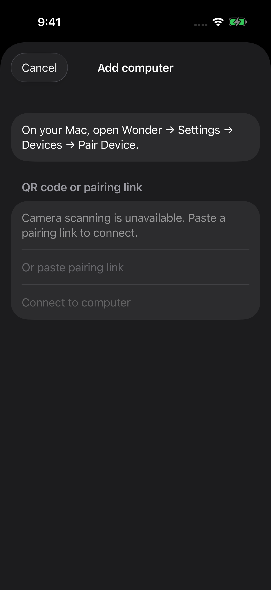

# Set up Cupola

The short setup is in the [README](README.md#install): Cupola for Mac, Cupola on
your iPhone or iPad, the same Wi-Fi to pair. This guide adds the details for
each agent, permissions, Tailscale, notifications and troubleshooting. An AI
agent setting Cupola up for someone follows [SETUP.md](SETUP.md).

## Requirements

| You need | Details |
| --- | --- |
| Mac | Apple silicon, macOS 14 or later, with Cupola for Mac (`Cupola.app` and the `cupola` command). |
| iPhone or iPad | iOS or iPadOS 26 or later, with Cupola. |
| Network | The same Wi-Fi as the Mac. [Tailscale](#away-from-home-tailscale) is optional, to reach the Mac away from home. |
| An agent | At least one, installed and signed in on the Mac. Its own plan and limits apply. |

Download Cupola for Mac from
[the latest release](https://github.com/swaymun/cupola/releases/latest). The
ChatGPT desktop app is optional.

## Install on the Mac

Install with Homebrew (`brew install --cask swaymun/tap/cupola`), or follow the archive’s
[INSTALL.txt](distribution/macos/INSTALL.txt): move `Cupola.app` to Applications
and link `cupola` onto your PATH. Then run
`cupola init`, `cupola service install` and `cupola doctor`. The service starts
the host now and at every login. Keep the Mac awake and online for the phone to
connect. Conversations, pairing and settings live in `~/.cupola` and survive
upgrades and reinstalls. An older `~/.wonder` folder is moved there the first
time the new host starts.

Updating depends on how you installed: Homebrew installs update with
`brew upgrade --cask cupola` (then `cupola service restart`); installs from
`install.sh` update with `cupola update`; a Mac zip install has no update feed,
so download the new zip and replace Cupola.app, then `cupola service restart`.

The app is signed and notarized. If macOS cannot verify it, get it again from
where you were given it and report the problem; keep Gatekeeper on.

## Agents

`cupola providers` shows each agent Cupola found and whether it is signed in.
`cupola providers login codex|claude|opencode` runs that agent’s own sign-in in
the terminal. Cupola never changes a sign-in on its own.

### Codex

Install the Codex CLI (`npm install -g @openai/codex`, or Homebrew) or the
ChatGPT desktop app, then run `cupola providers login codex`. When the ChatGPT
app is installed, Cupola runs the Codex inside it; otherwise it runs the `codex`
on your PATH. The ChatGPT app is optional: it adds its own threads to follow on
the phone and its own computer use.

Whoever installed Codex updates it: the ChatGPT app, npm or Homebrew. Cupola
switches to the new version when no Codex reply is running. If Cupola says the
installed Codex is too old or too new for it, update that Codex or Cupola as the
message says; don’t bypass the check.

### Claude

Run `cupola providers login claude` and finish Claude Code’s subscription
sign-in in that terminal. Cupola includes the Claude Agent SDK and its Node
runtime: no separate Node or Chrome extension is required. Subscription sign-in
is the default. You can instead use your own `ANTHROPIC_API_KEY` (or
`ANTHROPIC_AUTH_TOKEN`) and `ANTHROPIC_BASE_URL`, from the service environment
selection below or Claude Code’s user `settings.json` `env` object. The phone
reports **Claude subscription** or **API key**; API-key access does not claim
subscription usage limits. `CLAUDE_CONFIG_DIR` selects the same native folder
for history, sign-in and the runtime.

Access choices use the Project’s folders and Claude Code’s permission rules.
Claude usage appears in the computer’s Settings on the phone. Cupola checks once
a day for a newer patch of its bundled SDK and switches to it when no Claude
reply is running; until then the phone shows **Update ready**. A new SDK release
line needs a Cupola update, and an update that fails its checks keeps the
working runtime.

### OpenCode — experimental

Install and configure [OpenCode](https://opencode.ai/docs/) on the Mac. Cupola
detects its CLI automatically; `cupola providers login opencode` opens its native
sign-in. OpenCode owns its provider sign-ins, API keys and local models; Cupola’s
**Installed** status confirms the CLI, not access to every model. Cupola does not
forward arbitrary environment variables used by `{env:NAME}` credentials, so keep
credentials in OpenCode’s sign-in store or configuration file.

OpenCode’s own configuration controls permissions. Cupola forwards its approval
requests and lets you allow once or decline; Cupola’s access choices are
unavailable for OpenCode. Native Plan mode follows the configured agent’s rules.
Send slash commands separately from attachments: OpenCode’s command path can
drop attached files. If a reply’s outcome cannot be confirmed, Cupola keeps it
blocked instead of sending a duplicate; check the session in OpenCode on the Mac
before starting a replacement. Cupola resumes OpenCode threads it created;
importing other OpenCode sessions, forking and reasoning effort are not offered.

### Cursor — experimental

Install the Cursor CLI (the `agent` command) on the Mac with
`curl https://cursor.com/install -fsS | bash`, then sign in with `agent login`
(or `cupola providers login cursor`, which runs it). Cupola adds no Cursor
accounts. Cursor’s own configuration controls permissions. Cursor threads use
Cupola’s thread tools and, when Cua Driver is set up, the Mac’s apps (computer
use), as OpenCode threads do. They cannot be continued in Terminal from the
phone, and forking is not offered.

### T3 Code

Open T3 Code on the Mac. On the phone, go to Settings → your computer →
**Connected apps** → **Connect T3 Code**. Messages to a thread open in T3 Code
then go into it there, without stopping it. Cupola signs in to T3 Code again
before its 30-day grant ends.

## Computer view and permissions

Computer view (watching and controlling the Mac’s screen from the phone) is off
until you turn it on:

```sh
cupola stop
cupola init --computer
cupola permissions grant
cupola service restart
```

Allow **Screen Recording**; control also needs **Accessibility** and an unlocked
Mac. `cupola permissions status` checks without prompting. `cupola computer
control off` lets the phone only watch; `on` allows Take control again.

Agents use the Mac’s apps (computer use) in one of two ways. Codex from the
ChatGPT app uses ChatGPT’s own computer use. Codex CLI, Claude and OpenCode use
[Cua Driver](https://cua.ai/docs/cua-driver/quickstart) when it is installed and
**Control this computer** is on (phone: Settings → your computer → Connected
apps). Run `cupola doctor` to check the driver. Cursor uses the same driver.

Dictation uses Apple speech on the phone. Voice mode streams audio from the phone
to OpenAI with an OpenAI key you set on the Mac (`cupola config set voice-key`, or
**Settings → Voice → Add a key…** on the phone). With several Macs paired, Settings →
Voice picks whose key voice uses; the key stays on that Mac. Transcripts are kept
on that Mac as text when **Keep transcripts** is on.

## Pair your phone

1. Put the phone on the same Wi-Fi as the Mac.
2. On the Mac, run `cupola pair` for a short-lived QR code and pairing link.
3. In Cupola on the phone, tap **Add computer** and scan the code, or paste the link.
4. The phone shows a verification text. Type it at the Mac’s prompt to let it connect.



Pairing codes and links are private and expire. Never post one or share it with
someone you do not want to authorize. Being on the same network, or the same
tailnet, never pairs a device by itself. If the Mac’s address changes, choose
**Pair again** in Settings → your computer with a fresh code; chats and drafts are
kept.

## Away from home: Tailscale

Optional. Install [Tailscale](https://tailscale.com/download) on the Mac and the
phone, sign both in to the same tailnet, and turn on MagicDNS and HTTPS
certificates (if the tailnet belongs to an organization, its administrator may
need to). Cupola notices Tailscale by itself; no new setup or pairing.
`cupola routes` lists every way the phone can reach the Mac, and `cupola lan
off` turns off same Wi-Fi connections.

Cupola uses private [Tailscale Serve](https://tailscale.com/docs/features/tailscale-serve),
never public Funnel. It reuses an existing Cupola Serve entry or takes port 8443,
and leaves unrelated Serve entries alone.

## Notifications

Optional. In the computer’s Settings on the phone, turn on **Notifications** and
sign in with Apple; only notifications and Live Activities need that. Previews of
replies, approvals and questions are encrypted on the Mac before they reach the
push service, and Cupola stays quiet while it is open. Turning notifications off
leaves chat usable.

## Troubleshooting

| What you see | What to do |
| --- | --- |
| The phone can’t find the Mac | Same Wi-Fi on both (or Tailscale connected on both); Mac awake; `cupola status` shows the host running. Run `cupola doctor` and follow its fixes. If macOS asked about incoming connections, it must be **Allow**. |
| An agent is missing, signed out or incompatible | Run `cupola providers`; install or sign in as in [Agents](#agents); then **Reconnect** on the phone. For a version mismatch, update that agent or Cupola as the message says. |
| Pairing code expired | Run `cupola pair` again. |
| Screen is unavailable or control does nothing | `cupola permissions status`, then `cupola permissions grant`. Unlock the Mac. |
| Tailscale is offline or HTTPS setup fails | Connect both devices to the same tailnet; turn on MagicDNS and HTTPS certificates. Don’t reset unrelated Serve entries. |
| Notification permission denied | iPhone Settings → Notifications → Cupola, allow, then turn the Cupola switch on again. |

When reporting a problem, include Cupola and OS versions and use made-up content.
Never attach database files, tokens, pairing links or private screenshots. See
[security reporting](SECURITY.md).

## Updates

To update, run `cupola update`, or install a newer Cupola for Mac as
INSTALL.txt’s “Upgrading” describes; your phone stays paired. `cupola update`
verifies the download and its signature, and asks before restarting while agents
are working. Phone updates come from TestFlight, and from the App Store after
launch.

## Building your own apps

See [DEVELOPMENT.md](DEVELOPMENT.md) for prerequisites and Mac build commands.
The official TestFlight app can pair with a source-built Mac and use Cupola’s
push service.

If you build or re-sign iOS under your own Apple identity, configure both the main
app and Notification Service Extension identities, their shared Keychain access,
provisioning, and matching APNs environment. You also need your own APNs key and
push Worker. Follow [the push deployment guide](services/push/README.md); keep
private keys in service secrets, never in an app or Git.

## Linux host — experimental

Linux runs the same authenticated Project/chat daemon under `cupola`, a
headless command-line supervisor. `cupola service`
starts it at boot and `cupola update` installs new releases. iPhone dictation
still runs on iOS.
Use a dedicated non-root Linux account; install and sign in to providers on that
machine. Do not copy another computer's Cupola data or provider credentials.

The qualified development environment is Ubuntu 26.04 aarch64, Rust 1.94.0 and
Node 22.22.1. The daemon and supervisor compile there, and synthetic providers
exercise the normal pairing and Project APIs without model calls. An iPhone
simulator also paired over private VM HTTPS, opened history and files, and used
real Linux video and keyboard input. x86_64 binaries compile and start under
QEMU, but complete x86_64 acceptance, live provider conversations and video
across a tailnet remain unqualified. Linux cannot take over another app's running
Claude process; finish that work in its own app before continuing in Cupola.

### Build and install

From the repository root, with [Rust](https://rust-lang.org/tools/install/)
1.94 or later and Node 22 or later installed:

```sh
sudo apt-get install build-essential pkg-config libheif-examples libheif-plugin-libde265
cargo build --locked --release -p wonderd --features experimental-headless --bins
mkdir -p "$HOME/.local/bin" "$HOME/.local/share/wonder/acp-runtime" "$HOME/.local/share/wonder/claude-runtime"
install -m 755 target/release/wonderd target/release/cupola "$HOME/.local/bin/"
cp services/acp-runtime/*.mjs services/acp-runtime/package.json "$HOME/.local/share/wonder/acp-runtime/"
cp services/claude-runtime/*.mjs services/claude-runtime/package*.json "$HOME/.local/share/wonder/claude-runtime/"
npm ci --prefix "$HOME/.local/share/wonder/claude-runtime" --ignore-scripts --omit=dev --no-audit --no-fund
export PATH="$HOME/.local/bin:$PATH"
```

The libheif package supplies HEIC/HEIF-to-JPEG conversion for attached photos;
its decoder plugin is separate on Ubuntu 26.04. PNG, JPEG, GIF and WebP pass
through unchanged. Unsupported formats explain how to attach a PNG/JPEG instead.
Original files and their hashes remain intact. To run the HEIC fixture test,
also install `libheif-plugin-x265` (the test's encoder).

Install the official Codex npm release matching `compatibility-manifest.json`
(currently `@openai/codex@0.162.0-alpha.17.2`) and add its `bin` directory to PATH.
`cupola` resolves npm's native aarch64/x86_64 binary and verifies the normal
runtime contract; it does not bypass compatibility checks. Run `codex login
--device-auth` to sign in. For Claude, run
`node "$HOME/.local/share/wonder/claude-runtime/manage.mjs" login` to use its
subscription login, or configure an API key and endpoint as described below. For OpenCode, install and configure its native CLI
using the [official setup](https://opencode.ai/docs/); the limitations in the
OpenCode section above apply on Linux too.

### Provider endpoints and the service environment

Cupola uses the provider CLI’s own configuration. Codex `config.toml`
`model_providers.<name>.base_url` continues to work; Cupola does not rewrite it.
OpenCode and Cursor likewise keep their native configuration files. An external
pooling tool such as CLIProxyAPI may supply an endpoint to those CLIs; Cupola
has no account pool, rotation or fallback of its own. The endpoint must implement
the API expected by that CLI. This is configuration passthrough, not a claim
that every CLIProxyAPI provider, authentication mode or proxy feature works.

Background services do not inherit your whole terminal environment. Before
`cupola service install`, set
`CUPOLA_PROVIDER_ENV` to a comma-separated list of variables to copy, for example:

```sh
export CUPOLA_PROVIDER_ENV=ANTHROPIC_API_KEY,ANTHROPIC_BASE_URL,CLAUDE_CONFIG_DIR,OPENAI_BASE_URL,OPENAI_API_KEY,HTTPS_PROXY,NO_PROXY
cupola service install
```

Set the named values in that same shell. Only selected names and the existing
host-launch settings are saved in the private `launch-environment.json` under
the host’s state directory. This file contains the selected credentials; do not
share it. Linux also records them in its systemd unit, which stays readable only by you
when `cupola update` retargets it. To change or
remove a value, stop the host and run the start/install command again with the
new selection. An empty selection forwards no provider variables from the shell.
User configuration files remain active independently of this selection.

Name the exact variables used by your CLI; examples include:

- `ANTHROPIC_API_KEY`, `ANTHROPIC_AUTH_TOKEN`, `ANTHROPIC_BASE_URL`,
  `OPENAI_API_KEY`, `OPENAI_BASE_URL`, `CURSOR_API_KEY`, or any custom Codex
  `env_key` name (for example `MY_PROVIDER_SECRET`).
- `CLAUDE_CODE_OAUTH_TOKEN`, `CODEX_HOME`, `CLAUDE_CONFIG_DIR`,
  `CURSOR_CONFIG_DIR`, `CURSOR_DATA_DIR`, `OPENCODE_CONFIG`,
  `OPENCODE_CONFIG_DIR`, `OPENCODE_CONFIG_CONTENT`.
- `HTTP_PROXY`, `HTTPS_PROXY`, `ALL_PROXY`, `NO_PROXY`, and their lowercase forms;
  `SSL_CERT_FILE`, `SSL_CERT_DIR`, `NODE_EXTRA_CA_CERTS`.
- `XDG_CONFIG_HOME`, `XDG_DATA_HOME`, `XDG_CACHE_HOME`, `XDG_STATE_HOME`.

Names must be ordinary environment identifiers (letters, digits and underscores,
not starting with a digit). The provider selection cannot copy names prefixed
`WONDER_`, `CUPOLA_`, `LD_`, `DYLD_`, `NODE_` (except `NODE_EXTRA_CA_CERTS`),
`PYTHON`, `RUBY`, `BASH`, or `LC_`; nor `HOME`, `PATH`, `USER`, `LOGNAME`,
`SHELL`, `TMPDIR`, `LANG`, `ENV`, `SHELLOPTS`, `ZDOTDIR`, `IFS`, `CDPATH`, or
`GCONV_PATH`, or `TS_AUTHKEY`. These exclusions preserve host ownership and prevent executable
injection. Excluded and unselected names are not copied by this channel. The
host still supplies its standard process environment and launch paths.
Proxy and endpoint
semantics still belong to the selected CLI. In particular, the tested Codex
CLI reached the fixture with `config.toml.base_url`; its default provider did
not honor `OPENAI_BASE_URL` in an unauthenticated fixture. Use the native
configuration-file endpoint when that CLI version requires it. Claude reads only its user settings’
recognized access/endpoint/proxy environment fields here; this does not enable
user hooks or MCP servers outside the existing Project permissions. User environment fields take precedence over shell access settings, matching
Claude Code; Cupola keeps the host identity and selected config folder fixed.

Verification uses temporary homes, a private service-environment file, the
production runtime environment filters and local HTTP fixtures for all four
provider families. Claude additionally exercises its bundled real SDK/CLI with
shell and user-settings credentials. These checks do not establish real-provider
billing, subscription refresh, a running Linux systemd service, or compatibility
with a particular external pooling deployment.

`cupola providers` reports local runtime discovery. A runtime being
installed does not prove its account or a model is available.

`cupola doctor` checks the setup (initialized, wonderd beside `cupola`, host
running, Tailscale, computer-view tools, Cua Driver, providers) and names a fix for each
problem; it exits 1 when a check failed. Every command accepts `--json` and then
prints one JSON object (`pair` prints one per line); the shapes are documented in
`crates/wonderd/src/headless/cli.rs`.

Other commands: `cupola logs [--follow]` shows the background host's log;
`cupola devices rename <id> <name>` names a phone in the list;
`cupola devices revoke <id>` disconnects a phone and `cupola devices forget <id>`
then removes it from the list. `cupola providers login <provider>` runs the provider's own sign-in in
your terminal for this computer's own account (`codex login --device-auth`
prints a code to enter on OpenAI's page from any browser; Claude Code runs its
own login, OpenCode `opencode auth login` and Cursor the Cursor CLI's `agent
login`), then reconnects the provider. OpenCode needs no sign-in for models it
already offers; its login only adds providers. Cupola uses each computer's own
provider sign-in. Added sign-ins and account switching are no longer supported;
legacy threads open as saved, read-only history and their homes stay on disk.
Use the provider's own command to sign out on this computer.
`cupola config get|set host-name [name]` reads or changes the name your
iPhone shows; `cupola config set voice-key` reads an OpenAI key for voice mode
from standard input (type it, or pipe it from your password manager), checks it
with OpenAI and keeps it in `~/.wonder/secrets/voice-openai-key`, readable only by
this Linux user (mode 0600). It never appears in arguments or output.
`cupola permissions status` reports none needed on Linux.

### Install from a release

The one-line installer in [SETUP.md](SETUP.md#linux) installs the newest
release. To install from another release folder (set `WONDER_UPDATE_URL` to it)
without that script, this checks the archive's SHA-256 before anything is unpacked:

```sh
set -eu
feed="${WONDER_UPDATE_URL:?set WONDER_UPDATE_URL to the release folder}"
target="linux-$(uname -m)"
manifest="$(curl -fsSL "$feed/stable.json")"
version="$(printf '%s' "$manifest" | python3 -c 'import json,sys; print(json.load(sys.stdin)["version"])')"
url="$(printf '%s' "$manifest" | python3 -c "import json,sys; print(json.load(sys.stdin)['artifacts']['$target']['url'])")"
sha="$(printf '%s' "$manifest" | python3 -c "import json,sys; print(json.load(sys.stdin)['artifacts']['$target']['sha256'])")"
case "$url" in http*) ;; *) url="$feed/$url" ;; esac
tmp="$(mktemp -d)"
curl -fsSL "$url" -o "$tmp/wonder.tar.gz"
echo "$sha  $tmp/wonder.tar.gz" | sha256sum -c -
dest="$HOME/.local/share/wonder/versions/$version"
mkdir -p "$dest" "$HOME/.local/bin"
tar -xzf "$tmp/wonder.tar.gz" -C "$dest" --strip-components=1 --no-same-owner
ln -sfn "$dest/cupola" "$HOME/.local/bin/cupola"
ln -sfn "$dest/wonderd" "$HOME/.local/bin/wonderd"
rm -rf "$tmp"
export PATH="$HOME/.local/bin:$PATH"
cupola version
```

A release folder holds `stable.json` and `nightly.json` (the latest of each
channel) and `versions/<version>.json`, each
`{"version": "…", "artifacts": {"linux-x86_64": {"url": "…", "sha256": "…"}}}`,
next to archives holding one folder with `cupola`, `wonderd` and the runtime
folders. Releases come over HTTPS (plain HTTP only from `127.0.0.1`).

`cupola update` checks the same feed: `--check` only reports, `--channel nightly`
follows daily builds, `--version X` installs that exact release. It downloads and
verifies the SHA-256, unpacks the release beside the current one under
`~/.local/share/wonder/versions`, checks that it runs, and only then switches the
`~/.local/bin` links. If the host is running it restarts it on the new version;
when agents are working it asks first, and their work pauses and continues after
the restart. If an agent starts working between the question and the restart,
it asks again rather than interrupting work you did not agree to. Without a
terminal to ask in it leaves the restart to you (or pass `--yes`). The previous
release, and the one a not-yet-restarted host still runs, are kept: point the
links at one to go back.

### Start and pair

Install [Tailscale for Linux](https://tailscale.com/download/linux), sign in on
Linux and iOS, and enable MagicDNS/tailnet HTTPS. Then:

```sh
cupola init --name "Linux workstation" --https-port 8444
cupola start --foreground
# In a second terminal, as the same Linux user:
cupola status
cupola pair
```

Scan the terminal QR code in Cupola, or enter its origin and code in Add computer.
Read the verification text on the phone and enter it at the Linux terminal.
Released hosts always require the person's phone verification text;
they have no `--yes` option. Team development builds (Cargo feature
`dev-pairing`, used only by `scripts/pair-device` for automated phone tests)
add `--yes`, which approves the first phone to claim that command's own offer.

An interactive terminal shows the matched **Verification text** only after the
daemon accepts the phone's text. With `--json`, `pair` flushes one NDJSON `offer`
event immediately, then a `verification` event containing only device metadata
(`deviceId`, `label` and `hostInstallationId`). Ask the person to read their phone's text, then run
`cupola pair --approve <deviceId> --code <text>` in another shell. Missing or
incorrect text is refused. JSON and redirected output never contain the
verification text; the waiting command emits `connected` (or `rejected`).
Timeout, errors and Ctrl-C cancel that
offer. (Dev-pairing builds only: `--yes --watch-stdin` also cancels when the
controlling input pipe closes, including an SSH disconnect.) `cupola pair --cancel <offerId>` cancels
an exact offer and its pending requests; repeated cancellation is safe.

For agent-only pairing of Cupola from a source checkout on a Mac,
use `scripts/pair-device --host local|linux-build-host|windows-build-host --device <UDID>`.
It builds the Diagnostics runner before making an offer, uses Add computer through
XCTest, and checks both the app's saved computer and the host's device list.
See [agent pairing and signing](apps/ios/CONTROL.md#pair-cupola-with-a-live-computer)
for CLI paths, existing USB profiles, simulator leases, evidence and failures.

The daemon binds to `127.0.0.1:3777`; public/LAN binds are rejected. The default
transport is private Tailscale Serve. Startup refuses an HTTPS port used by
another service or exposed through Funnel; choose a free `--https-port` instead.
It preserves other Serve entries. `--tunnel none --origin https://…` is available
for an HTTPS reverse proxy you already control; it still binds only to loopback.
No proxy or certificate is installed in that mode.

For background use, omit `--foreground`. To start the host automatically, run
`cupola service install` once: it writes a systemd user unit
(`~/.config/systemd/user/wonder.service`) with the environment of the shell you
run it from (PATH and the `WONDER_*` runtime variables), starts it, and turns on
lingering (`loginctl enable-linger`) so the host starts at boot without anyone
signing in. If your system does not let you turn on lingering, it says so and the
host starts at sign-in. `cupola service status|restart` show and restart it;
`cupola start`/`cupola stop` go through the service while it is installed.
`cupola service uninstall` stops it, removes the unit and turns lingering back
off if it turned it on; if lingering cannot be turned off it says so, and running
it again retries. `cupola stop` asks its private supervisor socket to stop the owned process
groups; it never kills a PID found in a saved file. An exited child stops the whole
host, so a service manager may restart it. Logs are under `~/.wonder/logs`.
The stable Serve entry is retained after stop; if retiring this host, inspect
`tailscale serve status` and remove only its exact port with
`tailscale serve --https=8444 off`. Never reset unrelated Serve configuration.

### Optional virtual computer

The experimental helper shares a dedicated 1280×800 X11 display, not an existing
Wayland or logged-in desktop. Install its dependencies and restart with computer
view enabled:

```sh
sudo apt-get install xvfb openbox xdotool xclip
cupola stop
cupola init --name "Linux workstation" --https-port 8444 --computer
cupola start --foreground
```

Windows/Linux archives include the native computer helper where a
verified SDK is available (currently x64), and use it by default. Other targets,
including ARM64, keep the included Python helper as their screen sharing backend.
Each archive's `computer-backends.json` and release manifest's
`nativeComputerHelper` flag say whether native is included; `cupola doctor`
reports the selected backend and explains an unavailable one. The native backend
needs no Python or pip. Linux still needs the X11 tools above, including xclip
for clipboard actions; pure Wayland is unsupported. Windows shares the signed-in
user's desktop, so run Cupola in that user's session (`cupola service install`
starts it at their sign-in). `WONDER_COMPUTER_BACKEND=python` (PowerShell:
`$env:WONDER_COMPUTER_BACKEND = 'python'`) selects the Python fallback on either
platform and `native` selects the included helper; restart Cupola after changing
it. For Python sharing, install Python 3.12+,
create a venv, install the included `computer-linux/requirements.txt` (or
`computer-windows/requirements.txt`) with that venv's pip, and set
`WONDER_COMPUTER_PYTHON` to its interpreter. `cupola service
install` saves the current selection for login startup. Missing selected helpers
fail with an actionable message instead of changing backends. Keep the complete
archive contents together; no separate Cupola helper download is needed.


Run a GUI application as that same Linux user with `DISPLAY=:1` and
`XAUTHORITY="$HOME/.wonder/headless/Xauthority"` to put it on the shared display
(adjust the path if using `WONDER_DATA_DIR`). The display uses a private cookie
that changes on every host start; other Linux accounts cannot connect.
View and Take control use Cupola's normal paired-device consent
and short input leases. Mac-specific window/app shortcuts are hidden on Linux;
keyboard input, pointer, scroll, Escape and Tab remain available. The helper does
not grant a model its own computer-use tool, change an agent's permissions, or
capture the owner's macOS screen.

To let agents use this display themselves, install the open-source
[Cua Driver](https://github.com/trycua/cua/tree/main/libs/cua-driver). Its installer
checks each download against the release's SHA-256 sums; read it before running:

```sh
curl -fsSL https://cua.ai/driver/install.sh -o cua-install.sh
less cua-install.sh
bash cua-install.sh --no-modify-path
~/.local/bin/cua-driver telemetry disable   # optional: it sends content-free telemetry by default
```

When a thread sends a message, Cupola looks for `cua-driver` in
`WONDER_CUA_DRIVER_BIN`, `PATH` or `~/.local/bin` and gives Claude and OpenCode
threads its `cua-driver mcp` tools on the shared display (not in plan mode).
Claude asks on your iPhone before each of its tool calls; OpenCode follows its own
permission settings. Codex threads get the same driver through Codex's own app
server.

Video uses direct WebRTC host candidates: a normal Tailscale network interface
and reachable UDP route are required. Tailscale Serve forwards the API, not video.
Userspace Tailscale, VMs exposing only TCP port forwards, audio capture, Wayland capture and
live quality changes are unsupported. A local Linux peer has verified VP8 video,
keyboard delivery and automatic lease expiry. An iPhone simulator has also
verified video, keyboard delivery and releasing control across the VM network.
A real tailnet media route remains a separate qualification step.

For local verification (with the dependencies above), run:

```sh
cargo test --locked -p wonderd --features experimental-headless -- --test-threads=2
"$HOME/.local/share/wonder/computer-linux/venv/bin/python" native/computer-use-linux/test_helper.py
```

These tests do not send provider prompts. The [paired HTTP replay probe](scripts/test-session-replay-http.py) also accepts `--host target/debug/cupola` to
exercise the supervisor with isolated synthetic providers.

## Uninstalling

On a Mac, follow “Uninstalling” in [INSTALL.txt](distribution/macos/INSTALL.txt).
Revoke paired devices you no longer want to authorize first (`cupola devices`).
Removing the app keeps your conversations and pairing in `~/.cupola`; delete that
folder only if you want them gone.

Removing Cupola does not uninstall Tailscale or reset its configuration. Remove
only Cupola’s Serve entry if no longer needed; preserve your other services. Remove
the phone app through iOS normally. Independently deployed push services and Apple
keys remain your responsibility to retire when they have no remaining clients.
