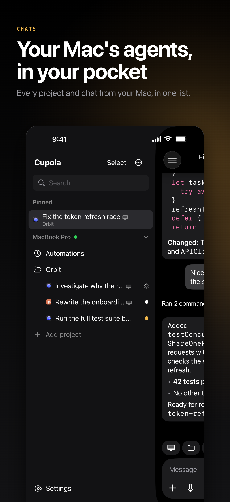
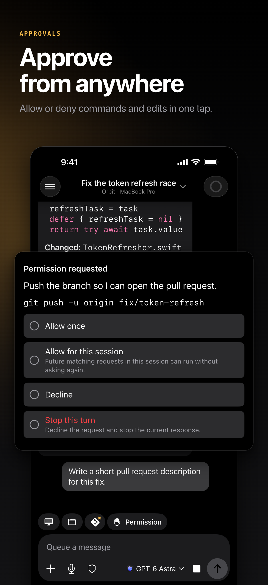

<p align="center">
  
</p>

<h1 align="center">Cupola</h1>
<p align="center"><strong>Your Mac’s agents, on your iPhone and iPad.</strong></p>

Cupola is a messenger for the coding agents on your Mac: Codex, Claude Code,
OpenCode, Cursor and threads started in T3 Code. Your Projects and their threads
show up on your phone. Reply, answer an agent’s questions, approve what it asks to
do, review code changes and files, and view your Mac’s screen. The agents keep
running on your Mac; conversations and files stay there, with local copies on your
paired devices. There is no account, subscription or model credits: your agents use
your own sign-ins and plans.

<p align="center">
  
  
</p>

This repository is the whole product: the Mac host, the iOS app and the optional
push service. It is MIT licensed.

## Install

**Mac** (Apple silicon, macOS 14 or later):

```sh
brew install --cask swaymun/tap/cupola
cupola init
cupola service install     # starts now and at every login
cupola doctor
```

**iPhone or iPad** (iOS 26 or later): join the [TestFlight beta](https://testflight.apple.com/join/2WSyUHZY).

**Pair:** with the phone on the Mac’s Wi-Fi, run `cupola pair`, tap **Add computer**
in the app and scan the code, then type the verification text the phone shows into
the Mac’s Terminal. Joining the same network alone never gives a phone access.

More detail, including Tailscale for away from home, agent sign-in, Linux and
Windows hosts and troubleshooting, is in [INSTALL.md](INSTALL.md). An AI agent
setting Cupola up for someone should follow [SETUP.md](SETUP.md).

## Build from source

Needs Rust, and Xcode on a Mac for the app. Full instructions and the checks are in
[DEVELOPMENT.md](DEVELOPMENT.md).

**Host** (Rust workspace in `crates/`):

```sh
cargo build --release -p wonderd --features experimental-headless --bin cupola --bin wonderd
cargo test --workspace
```

**iOS app** (`apps/ios`, Xcode, iOS 26 SDK). The signing team is left empty, so a
simulator build needs no Apple ID:

```sh
xcodebuild -project apps/ios/Wonder.xcodeproj -scheme Diagnostics \
  -destination 'generic/platform=iOS Simulator' CODE_SIGNING_ALLOWED=NO build
```

To run on a device, choose your own team and bundle identifiers in Xcode; see
[apps/ios/README.md](apps/ios/README.md).

## How it works

The `cupola` host (Rust, `crates/wonderd`) runs on your computer. It drives your
installed agents through their own interfaces (the Codex App Server, a bundled Claude
Agent SDK runtime, OpenCode, Cursor’s CLI and T3 Code’s MCP server), keeps Projects,
threads and history in a local SQLite store (`crates/wonder-store`) and serves a
signed HTTPS API (`crates/wonder-api`) that the native SwiftUI app (`apps/ios`, with
shared Swift code in `apps/native`) talks to directly over your Wi-Fi or Tailscale.
Pairing needs you at the Mac: the phone’s hardware-backed key is approved on the host,
every request is signed with it, and approvals, secrets and screen control are gated
on the Mac. An optional Cloudflare Worker (`services/push`) carries notification
previews that only your Mac and phone can decrypt.

## Contributing and security

- [CONTRIBUTING.md](CONTRIBUTING.md): how to propose and test a change.
- [SECURITY.md](SECURITY.md): how to report a vulnerability, and the trust model.
- [THIRD_PARTY_NOTICES.md](THIRD_PARTY_NOTICES.md) and [LICENSE](LICENSE).
