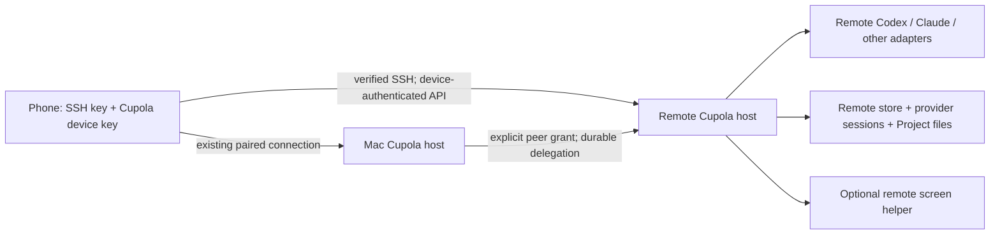

# SSH computers in Cupola — owner decision draft

2026-10-28 · W4-SSH-DESIGN · branch `agent/W4-SSH-DESIGN`

**Status: design and isolated feasibility spike; implementation not approved.**
This draft implements the research brief's broader owner decision: SSH is a
first-class way to add a computer, run that computer's installed agents, drive
their threads from the phone, and delegate between computers. The older row
4.5c describes only starting/installing a helper and tunneling an API; the current
brief supersedes that narrower wording. Pairing remains the richer Mac path.
This durable proposal lives in `docs/design/ssh-connections.md`; moving it out of
the run scratch area does not imply owner approval of its recommendations.

Evidence labels: **measured** means a current source inspection or recorded run;
**inferred** means an architectural recommendation based on those observations;
**guessed** means an estimate or untested capability. Source inspection proves
code contracts, not phone/runtime acceptance.

## Recommendation and boundary

**Inferred:** run the full Cupola host on the SSH computer. SSH bootstraps it and
carries an authenticated connection to it. The remote host owns the providers,
Project folders, queued messages, agent processes, approvals, artifacts and
durable history. A phone can connect directly to that computer over SSH; an
always-on Mac may optionally provide a gateway when the phone cannot reach it.
Neither mode moves execution ownership or the remote database onto the Mac.

Do not make the Mac's provider adapter a collection of remote `ssh codex` child
processes. That would make Mac sleep, restart, stdout loss and provider-home
discovery part of every remote agent's lifetime, and duplicate the headless host's
existing work. The spike deliberately uses that smaller transient transport to
answer feasibility; it is not the production architecture.

**Inferred:** SSH support should ship agents first, then cross-machine delegation,
then optional Linux viewing/control. X11 virtual desktops are a practical initial
screen surface. Existing Wayland desktops require a separate capability-dependent
implementation. Do not promise permission-free sharing on every Linux machine.



## Current implementation inventory

**Measured, source:** paths below are relative to
`the repository root, `; line numbers refer to
the W4 checkout inspected for this draft. Recheck after integration.

| Area | Evidence | Consequence |
| --- | --- | --- |
| Phone routes | `apps/native/Sources/WonderPairing/Protocol.swift:129`: `home`, `tailscale`, `relay`; `apps/ios/CONTROL.md:921`, `:922`, `:935` describe pinned home/Tailscale and sealed relay behavior | SSH is a new connection transport for the same computer identity, not a provider. The cited 697 in row 4.5c is stale. |
| Saved computers | `apps/native/Sources/WonderPairing/SavedConnections.swift:31` saves by `hostInstallationId` | Adding SSH to an already paired computer must merge routes and preserve drafts/read position. |
| Headless execution | `crates/wonderd/src/headless/main.rs:846`, `:969`, `:1014`, `:4034`, `:6077`: CLI/runtime discovery, supervisor and service environment | Use remote discovery and explicit executable paths; a login shell's PATH is not a systemd service's PATH. |
| Agent runtime | `crates/wonder-app-server/src/process.rs:232`, `:650`, `:680`, `:713`: local Codex and Node bridge children, verified runtime, notification sink | Remote host can reuse existing provider adapters. Do not bypass schema/helper verification in production. |
| Storage/replay | `crates/wonderd/src/main.rs:68`, `:84`, `:98`; `src/sync.rs:75` | Store and installation identity are local to each host. Replay uses that host's epoch and sequence. |
| Existing stdio bridge | `crates/wonderd/src/headless/main.rs:3131` uses loopback capability as local owner | Useful for local automation, unsafe as the phone's device-authenticated SSH endpoint. |
| Sealed device route | `crates/wonderd/src/rpc/sealed.rs:1`; `src/rpc/mod.rs:629` | Host proof, device authentication and bounded sealed HTTP/RPC already have owners; preserve them. |
| Delegate | `crates/wonderd/src/thread_tools.rs:1439`, `:1496`, `:1550`, `:1700` | No machine argument; child/provider/store/Project and execution root all resolve on the caller's host. |
| Delegation guards | `thread_tools.rs:55`, `:1466`, `:1550`, `:1730` | Keep task-only context, role, request replay/digest, narrowing of access/approval/speed, depth 3 and child limit 16. |
| Linux screen helper | `crates/wonderd/computer-helper/README.md:24`; `src/platform/linux.rs:703` | Existing native X11 capture uses MIT-SHM/Composite; input uses xdotool. Pure Wayland is outside that helper. |
| Virtual desktop | `crates/wonderd/src/headless/main.rs:1213` | Already starts Xvfb/openbox with Xauthority and no TCP X listener; SSH must not start a second conflicting fixed display. |
| Media plane | `crates/wonderd/src/computer_sessions.rs:1282`; `apps/ios/CONTROL.md:1104` | API connectivity does not prove media connectivity. Current WebRTC candidate routing and relay surface restrictions remain separate gates. |

Nightly context, measured again on 2026-10-28: main `.local/nightly/latest.md`
reports host status truth 22/23, with `claude/stop-before-harness-confirms` failing
its 1,000 ms budget (1,222–1,242 ms). Open nightly issue #554 tracks it. The
simulator host did not finish a report. These are unrelated lead follow-ups;
this unit changes no UI or production Claude lifecycle behavior.

## Connection and installation model

**Inferred proposed record:** `SSHConnection` stores connection ID, display name,
host/address, port, user, private-key reference, verified SSH host key(s), remote
installation ID and Cupola host-key pin, remote installation path/version and
last successful check. Keep secrets in the platform credential store; the record
contains references. IDs and pins do not change merely because DNS, a tunnel's
local port or the chosen route changes. IPv6 and nonstandard ports are supported
product inputs; the research spike accepts only an existing safe SSH alias.

1. Phone: Computers → Add computer → SSH. Enter host, port (22), user and select
   or create a key. Show the public key for the owner to install if necessary.
   No password/interactive sudo in the minimum. Do not export the private key.
2. Fetch the server's key during key exchange, display algorithm and SHA-256
   fingerprint, and require owner verification before user authentication or
   sending bootstrap commands. A pasted trusted fingerprint is preferable.
   An explicit first-use acceptance is recorded as TOFU, not independent proof.
3. After SSH authentication, inspect OS, architecture, supported Cupola install,
   service status and remote CLI locations. Return a bounded, typed inventory;
   never return environment dumps, auth files or shell startup output.
4. If missing, show the exact version, destination, download size and service
   effect before installation. Use checksum/signature-verified Cupola artifacts,
   private staging, atomic replacement and rollback. No curl-to-shell, root or
   arbitrary package installation. Unsupported OS/arch is explicit.
5. Bootstrap a normal Cupola device enrollment over the verified SSH channel:
   submit the phone's public device key and approve that exact device/nonce as
   the authenticated remote Unix owner. Return remote installation ID and host
   pin over this channel. Never use unattended `dev-pairing`, approve the first
   waiting phone, or put enrollment/session secrets in command arguments/logs.
   This needs a new narrow bootstrap command; it is not implemented today.
6. Start/reuse a per-user persistent remote service (Linux systemd user service;
   supervised foreground mode if a user manager is unavailable). Report whether
   it survives logout; request owner choice before enabling linger. Closing the
   phone disconnects transport, not accepted remote work. Bootstrap is idempotent.
7. Connect the phone to the remote host's device-authenticated API through SSH.
   Add/merge its ordinary saved computer record. Discover providers remotely;
   show Projects and threads through existing product views, with the computer
   named in the normal identity surface.

**Inferred transport recommendation:** an embedded iOS SSH actor opens
`direct-tcpip` only to the selected host's Cupola loopback endpoint. Carry the
existing sealed WebSocket/device-authenticated RPC inside it. Keep its actual
origin binding and host proof, with a stable logical endpoint and explicit
tunnel mapping; never use an ephemeral local port as the computer's identity.
Use a stream transport seam beneath existing clients rather than treating
`URLSession` as accepting arbitrary SSH byte streams. A private in-process
loopback tunnel is an alternative, but requires lifecycle/port/extension work.
Neither seam is implemented by this spike. The ordinary `cupola rpc` stdio bridge
must remain local-owner-only. An alternative device-scoped sealed stdio mode
would require its own framing/origin contract and security review.

The current origin validator (`crates/wonderd/src/lib.rs:3868`) accepts trusted
HTTPS origins and rejects loopback; `rpc/server.rs:156` requires a matched origin
before opening a sealed socket. Merely forwarding a port will therefore not
complete this integration. U3 must register a stable, host-bound SSH endpoint
identity during verified bootstrap and bind its HTTP Host/Origin and sealed proof
transcript to that identity. Keep the existing origin checks on other listeners;
do not accept arbitrary Origin headers or grant authority because a connection
arrived from loopback. The exact transport-origin representation is a U3 protocol
decision and must extend the current authority's fixtures before phone rollout.

Direct phone SSH must work without a Mac. Later, if a Mac gateway is selected,
relay only sealed remote-host traffic; validate the remote host proof end to end
and retain its installation ID. A lost gateway means “Gateway unavailable,” not
“Remote agent stopped.” Do not advertise direct reachability that was not tested.

**Guessed engineering choice:** evaluate an embedded SSH library in U1 before
committing to it. libssh2 exposes host-key bytes, a public-key signing callback
and direct TCP channels ([host keys](https://libssh2.org/libssh2_session_hostkey.html),
[sign callback](https://libssh2.org/libssh2_userauth_publickey.html),
[TCP channels](https://libssh2.org/libssh2_channel_direct_tcpip_ex.html)).
[SwiftNIO SSH](https://github.com/apple/swift-nio-ssh) is another candidate; verify
external signing, host-key policy, cancellation, channel limits, binary size and
license/package maintenance on actual iOS. This draft adds no dependency and
does not claim either library has passed the Secure Enclave integration gate.

## Keys, trust, enrollment and privacy

**Inferred policy, grounded in primary sources:**

- Imported Ed25519/RSA keys live in Keychain with device-only accessibility;
  import is explicit and parsed locally. Decrypted material exists only while
  signing; do not materialize a temporary private-key file. New keys should use
  a separate Secure Enclave P-256 signing identity per computer where supported.
  Apple limits Secure Enclave keys to P-256 and device-local operations; an
  imported Ed25519 key cannot be turned into a Secure Enclave key. Decide the
  unlock/background policy explicitly; user-presence signing cannot silently
  reconnect when locked. Do not reuse Cupola's device identity as its SSH key.
  [Apple security guidance](https://developer.apple.com/documentation/security/protecting-keys-with-the-secure-enclave).
- Secure Enclave signing needs SSH ECDSA signature encoding and a library signer
  callback; test DER/r,s conversion, leading zeros, algorithm negotiation and a
  real OpenSSH login. This is a proposed integration, not measured here.
- Pin SSH host keys against host/port and expected server identity before auth.
  Changed key stops the connection; separate owner action shows old/new public
  fingerprints and requires a trusted explanation. IP reuse/reinstall does not
  auto-replace it. Rotation may add a new pin only through an already trusted
  channel or separately verified owner action. `ssh-keyscan` is discovery, not
  verification. Keep the Cupola host pin separate: an SSH key match does not
  authorize silently replacing a Cupola installation.
- Follow strict host-key checking, key-only auth, bounded keepalives and no agent
  or X11 forwarding. The OpenSSH manual documents those controls and warns that
  forwarding an authentication agent lets a remote host use its identities.
  [OpenSSH configuration](https://man.openbsd.org/ssh_config).
- An SSH account generally has that Unix user's shell rights. Cupola Project
  controls cannot sandbox a malicious server administrator. Prefer a dedicated
  remote account for least privilege. Product transport must never infer a
  delegation grant merely from sharing an SSH destination.
- SSH credentials stay with their originating device/host. A Mac cannot use the
  phone's nonexportable Secure Enclave key after the phone sleeps. Cross-machine
  delegation uses separately provisioned peer credentials and a narrow grant.
  Do not solve it with agent forwarding or copying provider login files.
- Device revocation is checked inside the tunnel. Removing the SSH route closes
  its channels and forgets its key reference after outstanding use finishes;
  forgetting Cupola access and removing a public key from remote `authorized_keys`
  are distinct actions. Offer exact repair/removal, never broad SSH-file edits.
- Logs contain fixed failure codes, timings, counters and opaque connection IDs.
  No private keys, passphrases, provider tokens, cookies, enrollment secrets,
  raw stdout/stderr, prompts or host/user addresses in normal telemetry. Bound
  frames and sanitize diagnostic error bodies; opt-in diagnostics is not
  permission to log secrets. Remote output is untrusted even over authenticated SSH.

## Agent discovery and execution

**Inferred:** discovery happens on the remote host under the service's execution
environment. Reuse its provider catalog and availability contracts; report
installed/version-compatible/signed-in/ready as separate facts. Resolve PATH,
explicit owner override and absolute executable location once; verify the actual
binary/helper/schema, including Node bridges. Record OS/arch and useful repair
advice. SSH login-shell success must not count as service readiness.

Codex uses remote App Server stdio, existing initialization, approvals and event
normalization. The official contract separates thread creation from a model turn;
the probe uses `thread/start` and its `thread/started` notification only.
[Codex App Server](https://learn.chatgpt.com/docs/app-server).
Claude should use Cupola's existing Claude bridge/Agent SDK on the remote, keeping
subscription login and settings local there. Its official CLI also documents
stream-json and session resume; that supports headless operation, not an excuse
to replace Cupola's approval-aware bridge with terminal scraping.
[Claude CLI](https://code.claude.com/docs/en/cli-reference).
OpenCode/Cursor and future providers use their existing adapter and capability
contracts. A remotely installed arbitrary CLI is not automatically a drivable
Cupola provider; unsupported adapters are reported honestly.

No automatic provider installation or local-to-remote authentication migration.
Offer remote login instructions, or an explicit remote device-code flow supported
by the provider. Never copy `~/.codex`, `~/.claude`, API environment variables or
Keychain exports to make a missing login disappear. Installation/update actions
name the destination and effect and need the corresponding owner choice.

## Thread ownership, storage and sync

**Inferred:** canonical `ThreadRef = (hostInstallationId, conversationId)`;
provider/native-session identity remains metadata owned by that remote host.
Keep provider history in its remote provider home and Cupola messages, receipts,
queues and runtime bindings in its remote store. The phone holds bounded cached
projections and pending send intentions, not a second executable thread database.
Mac gateways may cache references/status; never copy SQLite/WAL files while live.

Reuse checkpoints and replay as `(hostInstallationId, hostEpoch, sequence)`.
Switching LAN/Tailscale/SSH/relay for one host keeps its thread identity and cursor;
a changed epoch resets projections through the existing resync path. Never merge
two hosts' sequence numbers. One native thread is not resumed on a different
computer just because both have the same repository name.

After an uncertain send, query its durable receipt by the original request ID;
retry that same intent only through idempotent acceptance. Do not start a new
turn because SSH disconnected. Artifacts stay on their producing host and use
its authenticated download/preview with existing MIME/hash guards. Sending a file
to another computer is an explicit bounded transfer with hash and provenance,
not a silent path rewrite or implicit workspace sync.

## Cross-machine delegation contract

**Inferred proposed extension:** preserve omitted `computerId` as “this computer.”
Add optional opaque `computerId` and owner-approved `workspaceBindingId` to
`wonder_delegate`; extend discovery/model listing so an agent can select a
registered destination and only its available providers/models. A model must not
supply an arbitrary SSH hostname, credential, shell command or remote path.
Reuse generic computer capabilities; no provider-specific VM creation tool.

An owner links Project workspaces across computers explicitly. Same Project title,
Git remote or folder basename does not prove scope. The binding records source
Project identity, target Project identity/root revision and permitted paths/actions.
Host-to-host trust uses a revocable grant limited to this binding and delegation
operations; it must not impersonate a phone or carry local-owner authority.
Allow direct verified SSH transport or existing private reachability, with its own
peer key. A Mac parent can then delegate while its phone is disconnected.

1. Revalidate the calling thread's Project membership, effective access/approval/
   speed ceilings and target grant. Resolve the destination provider and workspace
   against the target's own catalog/root revision. Do not inherit an absolute
   local path or unbounded “full access” onto another Unix account.
2. Source persists an outbox intention containing source/target host identities,
   parent/Project, request ID, task digest, selected execution settings, ancestry
   and grant revision before transport. Key deduplication by source installation,
   parent and client request ID. Include destination/binding/settings in its digest.
3. Target atomically records an inbox receipt, creates the child and enqueues
   its first task. A repeated request returns the same child/receipt; reused ID
   with a changed task/destination fails. The source learns the target `ThreadRef`.
   There is no distributed transaction; durable outbox/inbox and receipt lookup
   supply recovery. Unknown acceptance must never cause an unrelated new child.
4. Pass only the task and role, matching today's delegate semantics. Do not send
   parent history, secrets or local files implicitly. Record source provenance
   and show the child under the destination computer, with a linked task from
   the parent; opening that reference uses the target's normal connection.
5. Retain depth 3/children 16 across host hops. Signed ancestry plus durable root
   budget reservations prevent resetting counters on each computer; cycles and
   forged local parent IDs fail closed. Root budget reconciliation is required
   after crashes, not a best-effort UI count. Target also applies its own quotas.
6. `mode=wait` waits on the target receipt/result for the existing bounded timeout.
   Timeout means “still running / connection unavailable,” not task failure.
   `send`, `read`, `wait` and `stop` follow only authorized remote child references;
   never turn a reference into general cross-Project browsing. Stop reports success
   only after remote acknowledgement; a lost connection leaves it unconfirmed.
7. Target records a terminal result once and source reconciles it through a
   durable result inbox. Completed/failed/interrupted remain distinct. A result
   may arrive after parent turn completion or reconnection without duplication.
   Peer revocation stops new calls and forwarding; it does not pretend that work
   already accepted on the remote was cancelled.

Unproven until implemented: two-host crash windows, concurrent delegation budgets,
peer revocation and approval identity. These are production security/storage
contracts that warrant extending the existing delegate/store fixtures, not a
new duplicate test suite.

## Failures and reconnect behavior

**Inferred product state machine:**

| State | User-facing meaning and recovery | Execution rule |
| --- | --- | --- |
| Needs verification | “Verify this computer's SSH key” | No auth/bootstrap until accepted. |
| Key changed | “This computer's SSH key changed” → review keys | Hard stop; no automatic pin update. |
| Key locked | “Unlock to connect” | Preserve intent; no password fallback. |
| Sign-in refused | Name the account/key problem; choose another key or repair remote login | No rapid retry loop. |
| Setup needed / failed | Install/start/repair exact remote host; show bounded progress and typed reason | Roll back this installation only. |
| Provider unavailable | Install/sign in/update on that computer | History remains readable when cached; sends are not claimed accepted. |
| Connecting / connected | Name the computer; route details only when useful | One session generation owns its channels. |
| Connection lost | “Can't reach …; work may still be running” | Keep accepted work, pending receipts and cached history. |
| Reconnecting | Backoff with jitter (proposed 1–30 s); retry on foreground/network change | Reverify SSH and Cupola pins, authenticate, reconcile receipt, checkpoint/replay. |
| Access ended | “This computer no longer accepts this device” → enroll again | Device revocation wins over cached sessions. |
| Gateway unavailable | Name the optional gateway and a reachable alternate | Do not say remote execution stopped. |
| No desktop / consent needed | Name missing X11 desktop or required remote desktop consent | Agent/chat capability remains independent. |

Cancellation/generation checks after each await prevent an old tunnel or bootstrap
completion from installing a connection after removal or switching computers.
Bound outstanding channels, read/write buffers, downloads and retry queues. App
backgrounding can close an SSH transport; durable remote work continues. Share
extension/widget access cannot assume the foreground app's socket is alive;
either establish an authorized short connection with the same key access policy
or explain that opening Cupola is required. Push comes from the remote host and
still needs its own existing push configuration; SSH itself provides no APNs.

## Linux screen sharing: source evidence and measured feasibility

**Primary-source-derived:** Xvfb runs without physical display/input hardware.
Its documented screen configuration and readback options make a private virtual
desktop viable on a headless SSH machine.
[X.Org Xvfb manual](https://xorg.freedesktop.org/archive/X11R7.5/doc/man/man1/Xvfb.1.html).
This is remote rendering/capture, not `ssh -X` forwarding a window to a Mac.

**Measured, isolated X11 run:** `linux-build-host`, existing VM, 2026-10-28. Script
`crates/wonderd/src/ssh_spike/screen_probe.py` allocates its own Xvfb display with
`-displayfd`, `-nolisten tcp` and a random cookie held in anonymous RAM (`memfd`).
No existing display/session bus is opened, no root install or package change.
Draw 30 different synthetic rectangles, capture each full root via XGetImage,
verify 30 distinct frame hashes, move pointer to (180,140) through xdotool and read
the resulting position. No pixel files or cookie/key material are retained.

| Measurement | Recorded result |
| --- | --- |
| Frame | 1280×720, 24-bit X display, 3,686,400 readback bytes |
| Samples / distinct frames | 30 / 30 |
| Median / worst raw readback | 6.531 ms / 10.517 ms |
| MIT-SHM / Composite / XTEST | All present |
| Pointer result | Requested position confirmed |
| Cleanup | Owned Xvfb exited; temp root removed; memory cookie closed |

This uses XGetImage to test available primitives, not the native helper's MIT-SHM
capture loop. It measures neither VP8 encoding, WebRTC ICE/TURN, sustained fps,
network latency, phone decode nor input-to-photon latency. A native helper binary
was not present in the expected helper-check cache, so this run does not claim
product helper or phone parity. No real desktop content was captured.

| Linux surface | Recommendation | What is and is not established |
| --- | --- | --- |
| Cupola-owned Xvfb | First supported SSH screen surface; start helper in remote host's display/auth environment, on demand | Measured raw capture/input without OS consent prompts; existing helper source supports X11. End-to-end media still open. |
| Existing X11 desktop | Optional explicit attach after selecting that session | Requires its display/Xauthority and owner authorization; SSH login alone is insufficient. Same-user X access is broad; do not weaken it with `xhost +` or `-ac`. Not measured here. |
| GNOME/KDE Wayland desktop | Use portal ScreenCast + RemoteDesktop, PipeWire and supported input bridge | Portal startup normally presents a consent dialog. Persistence can restore prior grants, but it is not an SSH permission bypass. Not measured. |
| Dedicated wlroots Wayland desktop | Later helper backend or gateway candidate | wayvnc supports headless wlroots sessions, explicitly excludes GNOME/KDE/Weston. Needs compositor setup and new media/client integration. Not measured. |
| GNOME headless/RDP | Separate future integration | GNOME Remote Desktop advertises headless modes; this does not prove compatibility with Cupola's WebRTC helper or prompt-free access to an existing login. Not measured. |

The portal source documents source selection, PipeWire streams and single-use
restore tokens; combined capture/input persistence belongs to RemoteDesktop.
Store such tokens as credentials and handle revoked grants; SSH cannot mint them.
[ScreenCast portal](https://flatpak.github.io/xdg-desktop-portal/docs/doc-org.freedesktop.portal.ScreenCast.html),
[RemoteDesktop portal](https://flatpak.github.io/xdg-desktop-portal/docs/doc-org.freedesktop.portal.RemoteDesktop.html).
wayvnc recommends localhost plus SSH tunneling for protection; that establishes
a transport option, not a ready Cupola phone feature.
[wayvnc upstream](https://github.com/any1/wayvnc),
[GNOME Remote Desktop upstream](https://github.com/GNOME/gnome-remote-desktop).

**Inferred media plan:** reuse remote helper/session authorization and its existing
WebRTC plane when phone and target have reachable LAN/Tailscale candidates.
SSH's direct TCP channel does not carry arbitrary WebRTC UDP. For SSH-only targets,
add an explicit media relay (properly authenticated TURN/TCP/TLS with understood
cost/availability), or a separately negotiated bounded encoded-video channel over
SSH with an iOS decoder. Do not tunnel raw frames: 1280×720×4×15 ≈ 55 MB/s before
overhead. TCP head-of-line blocking and competing file/event streams require a
separate benchmark. Until that unit passes, SSH-only computers offer agents and
threads, with screen viewing honestly unavailable. Existing relay chat reachability
must not be represented as proof of media support.

Linux still needs Cupola's own view/control grant, active session/lease, stop and
input protections. “No OS prompt on an owned X11 display” does not waive product
consent. On macOS, SSH does not grant Screen Recording/Accessibility: continue to
use the installed signed app and normal pairing/permission flow for richer sharing.

## Diagnostics spike and rerun

**Measured implementation:** `diagnostics-ssh-spike` is opt-in and the entire Rust
module additionally requires `debug_assertions` and Unix. No API/CLI route,
production transport or existing provider adapter changes. Default builds do not
include it; optimized Release builds exclude it even with the feature selected.
The Python payloads are research source, not packaged helpers.

`src/ssh_spike.rs` invokes OpenSSH with strict known-host verification, key-only
batch auth, no agent/X11/port forwarding and no shared control socket. It accepts
only a safe existing SSH alias; trusted user SSH config remains part of this
research harness's trust boundary. OpenSSH handles existing keys; the spike does
not extract, print or store them. A fixed Python payload creates private temporary
HOME/CODEX_HOME/work directories, clears inherited provider credentials/config
and launches the installed Codex CLI. Rust sends only initialize, initialized
and one ephemeral read-only thread/start. It bounds JSON frames/count/time,
correlates the actual thread response and notification in either order, then
closes stdin. Remote cleanup kills only its owned group before reaping its leader,
removes the temporary root, and emits a content-free cleanup acknowledgement.
A 25-second remote watchdog also bounds disconnected failures. Errors/stderr and
thread contents/IDs are never printed. Abnormal VM termination can still require
cleanup of this exact temp prefix; no broad user-data cleanup is authorized.

Recorded first run (Codex CLI 0.163.0): 5 frames before match;
`threadStarted=true`, `correlatedEvent=true`, first event 2,972 ms, total 3,146 ms,
`remoteCleaned=true`. A separate strict SSH invocation using empty known-host
stores and a fresh host alias rejected the unknown host key (exit 255).
This proves an installed CLI's real empty-thread event across SSH into the local
Rust host process. It is not a model-response stream, persisted Cupola ingestion,
remote service supervision, iOS connection, Secure Enclave authentication or
two-host delegation proof. No model turn or credentials were needed. Production
runtime compatibility verification remains mandatory; this isolated probe does
not claim the installed 0.163.0 runtime passed Cupola's full schema checks.

```sh
CARGO_BUILD_JOBS=4 cargo test -p wonderd --features diagnostics-ssh-spike --lib ssh_spike -- --nocapture
WONDER_SSH_SPIKE_HOST=linux-build-host CARGO_BUILD_JOBS=4 cargo test -p wonderd --features diagnostics-ssh-spike --lib ssh_spike_real_remote_cli_streams_one_empty_thread -- --ignored --nocapture
ssh -T -oBatchMode=yes -oStrictHostKeyChecking=yes -oForwardAgent=no -oForwardX11=no -oClearAllForwardings=yes -oPermitLocalCommand=no -oControlPath=none -- linux-build-host 'python3 -' < crates/wonderd/src/ssh_spike/screen_probe.py
scripts/preflight origin/main
```

Only use a previously verified research host. The VM was already running; this
unit created no VM, installed no provider/package, started no shared service and
did not stop another user's VM. The repository's VM lifecycle installs a
ForceCommand wrapper for guest SSH leases (`scripts/vms/gcp-linux-startup.sh:45`);
the spike uses the existing SSH alias and does not bypass that wrapper. No
production Cupola directory was opened.
The ordinary tests own option/shell injection, bounded untrusted JSONL and
cleanup confirmation. The injection test passes the exact `python3 -c` argument
from `ssh_command` through `/bin/sh`, intercepting Python invocation to verify
that the source arrives byte-for-byte as one argument. Cleanup accepts only a
JSON boolean `params.removed=true`; false, missing and mistyped values fail.
The real SSH test is ignored by default and run explicitly.

## Review reproduction, 2026-10-28

**Measured again during the repair of reviewed head `a754a954b`:** the existing
`linux-build-host` alias was reachable with strict pinned-host verification. No VM,
package or provider installation was needed. The commands above are the rerun
entry points; they use only a fresh empty thread and a synthetic owned desktop.
The Rust spike's ordinary tests passed (2 passed, 1 explicitly ignored live
case), including all cleanup cases and exact-command shell parsing. The explicitly
selected live Codex test then passed (1 passed, 0 ignored), returning:

```json
{
  "threadStarted": true,
  "correlatedEvent": true,
  "framesReceived": 5,
  "firstThreadEventMs": 1809,
  "elapsedMs": 1907,
  "remoteCleaned": true
}
```

Only initialize/initialized/thread-start were sent. First event was 1,809 ms and
total elapsed time 1,907 ms; response/event identity matched and cleanup was
confirmed. This re-establishes the SSH/CLI path directly during this repair, with
no reliance on the prior worker's report.

The X11 command exited successfully and returned this content-free result:

```json
{
  "width": 1280,
  "height": 720,
  "samples": 30,
  "distinctFrames": 30,
  "pointerRoundTrip": true,
  "extensions": {
    "MIT-SHM": true,
    "Composite": true,
    "XTEST": true
  },
  "frameBytes": 3686400,
  "readbackMedianMs": 6.439,
  "readbackMaxMs": 9.983,
  "existingDesktop": false,
  "remoteCleaned": true
}
```

Payload SHA-256 values bind the measurements to the reviewed scripts:

- `agent_probe.py`: `1265f36cc4804cfade3b0d08618cce980e7c005e3d20e4eb4bc4bb7d0b1f3859`
- `screen_probe.py`: `02fc135b7642fa52243d67f6f227547599d88ebcab2c251f2be1474e629c916e`

The prior worker's timings above remain historical observations, not substitutes
for this rerun. A failed cleanup acknowledgement now has explicit protocol
coverage. The exact full remote command also has a local shell-parser check,
so quoting can be checked without access to the SSH machine. The source inventory
failure was reproduced before repair; `thread/started` is now listed as optional
in `wonder_app_server::CONSUMED_NOTIFICATIONS`, since only this Diagnostics probe
requires it. Production runtime requirements have not been strengthened.

**Measured verification on rebased `origin/main` (`fcb7df5c6`):**
`cargo test --workspace -- --test-threads=4` passed with 1,452 passed, 0 failed
and 14 ignored (the explicitly selected SSH live test passed separately). The
exact notification inventory regression passed both alone and in that full run.
`scripts/preflight origin/main` passed; both Python payloads parsed and
`git diff --check` passed.

Before completion, main advanced to `2e5b99bad` (phone provider-account UI
removal). The branch was fetched/rebased again and all owning checks repeated:
workspace **1,452 passed, 0 failed, 14 ignored**; spike **2 passed, 1 ignored**;
explicit live SSH/Codex **1 passed, 0 ignored**; preflight passed. The final live
run received 5 frames, matched the thread response/event, recorded its first event
at **1,806 ms** and completion at **1,885 ms**, and confirmed remote cleanup.
The Python payloads and X11 probe were unchanged; the X11 measurement above
remains tied to their recorded hashes. These results supersede the older base's
verification as the final landing evidence.

## Proposed implementation units and order

**Guessed sizes:** S = 1–2 focused development days, M = 3–5, L = 6–10. Estimates
include owning validation/review, not elapsed parallel-run promises. Keep each
landable; no production implementation is included in this design branch.

| Order / unit | Surface and scope | Size | Depends / acceptance |
| --- | --- | --- | --- |
| U1 SSH trust/signing proof | iOS/native: embedded engine, Keychain import, Secure Enclave signer, host-key checking | M | First: real device key login, changed-key refusal before auth, cancellation/locked-key behavior; select dependency here. |
| U2 Remote bootstrap/service | Host CLI: signed install/doctor, idempotent service reuse, exact-device enrollment and rollback | M | U1 trust contract; clean Linux fixture, missing user-manager/logout cases; no owner RPC leakage. |
| U3 Device-authenticated SSH transport | Host + iOS/native: loopback SSH channel, sealed API stream seam, origin binding, connection generation/replay | L | U1–U2; phone send/approval/interrupt/artifact over isolated remote fixture; lost-reply receipt recovery. |
| U4 Add SSH computer and provider discovery | iOS + remote host: inputs/key/verification/setup UI, merge computer identity, remote capabilities/repair | M | U2–U3; iPhone/iPad/Duo before/after captures and targeted scenarios, no redundant SSH-only chat UI. |
| U5 Remote lifetime and extension recovery | Host + iOS: service continuity, network/background/restart, widgets/share limits and push configuration | M | U3–U4; accepted work survives transport loss, stale sessions cannot revive, no duplicate sends. Agents-first release boundary. |
| U6 Peer/workspace grants | Host/store/protocol: generic computer registry, independent peer keys, explicit cross-Project bindings and revocation | M | U2–U3; least-privilege authority fixtures, no phone key forwarding. |
| U7 Durable remote delegation | Host/store/tools: computer selection, outbox/inbox, receipts/results, distributed ancestry/budget, remote read/send/wait/stop | L | U6; extend existing delegate fixtures for crash/lost-ack/replay/revocation, local semantics preserved. |
| U8 Remote task navigation | iOS: linked remote ThreadRefs, destination badges and truthful result/stop states | S | U4/U7; two-computer fixture + platform captures, independent phone connection to child. Minimum owner goal complete here. |
| U9 Linux X11 helper qualification | Helper/host: on-demand owned display, source/control consent and cleanup, packaged helper | M | Agent path independent; actual helper-to-phone capture/input, session identity and closed-window guards; readback probe alone insufficient. |
| U10 SSH-only media transport | Helper + host + iOS: choose TURN or encoded SSH media after benchmark, separate control/event budgets | L | U3/U9; remote-to-phone encoded video latency/fps/loss/reconnect and consent; no raw framebuffer stream. |
| U11 Optional Wayland backend | Helper: portal/PipeWire/libei or explicit compositor-specific support | L | Separate decision after U9; at least GNOME/KDE consent/revocation plus a selected headless target, no blanket Linux claim. |

Host security/store work requires contract fixtures; UI work requires real native
captures and targeted scenarios on every changed platform. Lead owns combined
simulator/physical qualification and landing. Public source/releases, production
installation and provider-login changes remain separate authorized actions.

## Owner decisions still needed

1. Approve full remote host as canonical executor/store, direct phone SSH as the
   baseline, optional Mac gateway later? Recommended **yes**; avoids requiring an
   awake Mac for remote computers.
2. Confirm first-use host trust: pasted fingerprint encouraged, explicit recorded
   TOFU allowed? Recommended **yes**, with changed-key refusal and no automatic reset.
3. Key policy: recommend new Secure Enclave P-256 identities, explicit Keychain
   import fallback; require unlock to reconnect by default? Background/extension
   behavior must match this choice and be tested on a device.
4. Cross-machine Project binding and permissions: owner grants target workspace,
   per-peer identity and bounded capabilities before any agent can choose it?
   Recommended **yes**; no automatic sharing just from equal Git remotes/names.
5. Screen scope: ship agents/delegation first, owned X11 desktop next, Wayland and
   SSH-only video as separate qualified capabilities? Recommended **yes**. Is an
   owned virtual desktop sufficient, or must existing user desktop sharing block
   the screen milestone?
6. Installation UX: permit installing/updating the remote per-user Cupola host
   after reviewing a concrete plan, with provider installation/login separate?
   Recommended **yes**. Decide whether Mac gateway and media-relay availability
   warrant additional units only after the direct route works.

No owner decision is needed to review this isolated branch. The recommendations
above do not authorize shipping or promote this draft into agreed architecture.
